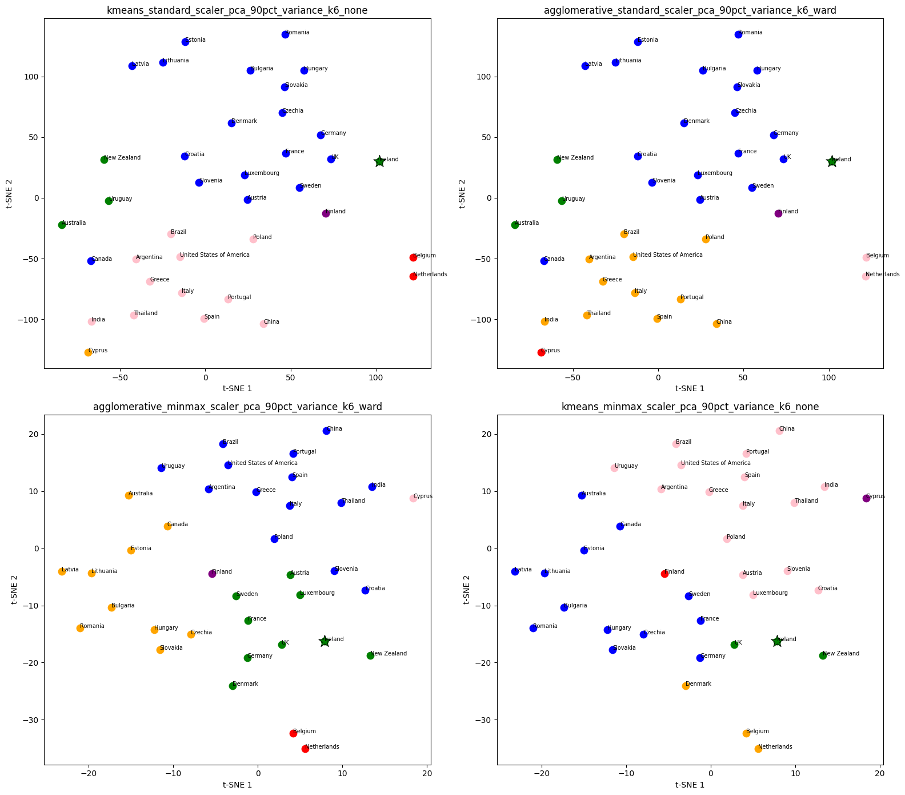

# Comparative Analysis of Irish Agriculture 🇮🇪

This project examines Ireland’s agricultural profile in comparison with other countries using international agricultural data, unsupervised machine learning and inferential statistics.

The analysis combines data collection, exploratory data analysis, feature engineering, dimensionality reduction, clustering and statistical testing to identify countries agriculturally similar to Ireland and investigate the differences between them.

The main results are also presented through an **[interactive Streamlit dashboard](https://agridashpy-hctjddlnnkkg9bxrtaw7zn.streamlit.app/)**.

## Project Objectives

The project aimed to:

* create a comparable international dataset of agricultural indicators;
* identify countries with agricultural characteristics similar to Ireland;
* evaluate alternative clustering methods and preprocessing strategies;
* compare Ireland statistically with its most consistent agricultural peers;
* highlight the characteristics that distinguish Ireland’s agricultural system.

## Data Sources and Licensing

The agricultural data used in this project were obtained from [FAOSTAT](https://www.fao.org/faostat/), the Food and Agriculture Organization of the United Nations' statistical database.

FAOSTAT data are generally available under the [Creative Commons Attribution 4.0 International licence (CC BY 4.0)](https://creativecommons.org/licenses/by/4.0/), subject to FAO's [Statistical Database Terms of Use](https://www.fao.org/contact-us/terms/db-terms-of-use/en) and any dataset-specific or third-party restrictions.

The original datasets were cleaned, transformed and combined to create the analytical dataset used for exploratory analysis, clustering and statistical comparisons.

**Attribution:** FAO. FAOSTAT statistical database. [https://www.fao.org/faostat/](https://www.fao.org/faostat/). Licence: CC BY 4.0, subject to the terms above.

The licence for the source data does not automatically apply to the project's original code, notebooks or analysis.

The original data covered the period from **2000 to 2024**. For the main machine-learning analysis, agricultural indicators were aggregated across **2015–2023** to represent recent agricultural structure while reducing year-to-year variation.

The final clustering dataset contained:

* **37 countries**;
* **47 agricultural features**.

The countries included European agricultural systems alongside selected international comparators such as Australia, New Zealand, the United States, Canada, Argentina, Brazil, Uruguay, China, India and Thailand.

## Methodology

### Data Preparation and Feature Engineering

The raw FAOSTAT datasets were cleaned, reshaped and combined using Python.

Derived features included:

* crop area as a share of agricultural land;
* cropland and pasture shares;
* milk production per hectare of permanent pasture;
* agricultural export values;
* product-group export shares.

Raw country totals were generally replaced with proportional or intensity-based indicators to improve comparability between countries of different sizes.

Missing values were investigated and handled before the modelling dataset was created.

### Clustering

Two unsupervised learning algorithms were evaluated:

* **K-Means clustering**;
* **Agglomerative hierarchical clustering** using Ward linkage.

Several preprocessing pipelines were compared:

* StandardScaler with PCA;
* MinMaxScaler with PCA;
* RobustScaler without PCA.

For the PCA pipelines, multiple explained-variance thresholds were tested.

Clustering solutions were evaluated using:

* Silhouette Score;
* Davies–Bouldin Index;
* cluster-size distribution;
* Ireland’s cluster membership;
* interpretability of the resulting country groups.

Solutions containing singleton clusters or one very large residual cluster were excluded from the final shortlist.

### Statistical Analysis

Ireland was compared with the countries that appeared most consistently in its strongest clustering solutions.

The statistical analysis used annual observations from **2015–2023** and included:

* confidence intervals;
* Welch’s independent-samples t-tests;
* Mann–Whitney U tests;
* one-way ANOVA;
* chi-square tests.

Normality was assessed separately for each country and variable before selecting the appropriate pairwise test.

## Key Findings

The clustering analysis identified recurring agricultural similarities between Ireland and a small group of countries. Across the shortlisted models, Ireland was consistently grouped with **New Zealand**, while its broader peer group varied depending on the clustering configuration. Other countries appearing alongside Ireland included **Australia, Uruguay and the United Kingdom**.

The t-SNE visualisation below illustrates how Ireland's cluster membership changes across the four shortlisted solutions.



*Figure 1. t-SNE projections of the four shortlisted clustering solutions. Colours indicate cluster assignments, with Ireland highlighted. The projections provide a visual overview of the groupings; conclusions are based on the clustering results and validation rather than visual separation alone.*

These results suggest that Ireland shares agricultural characteristics with several countries, although the composition of its peer group depends on the modelling approach. The statistical analysis also identified important differences within this group.

Notable findings included:

* Ireland had the highest barley yield among the selected peer countries;
* Ireland had a particularly high and stable share of agricultural land used as permanent pasture;
* Ireland’s dairy export share differed significantly from all four peer countries;
* Ireland had higher milk production intensity than Australia, Uruguay and the United Kingdom;
* significant differences were found across all variables included in the main multi-country ANOVA comparisons.

The clustering therefore identified countries with broadly similar agricultural profiles, while the inferential analysis showed that similarity at the overall system level does not imply equality across individual agricultural indicators.

## Interactive Dashboard

An interactive dashboard was developed in **Streamlit** to present the main agricultural indicators and comparisons between Ireland and its selected peer countries.

The dashboard includes:

- an interactive map showing Ireland and its agricultural peers;
- agricultural land-use summaries;
- crop production and yield indicators;
- dairy, meat and egg production indicators;
- agricultural export comparisons;
- year-based filtering for the period 2015–2023.

The dashboard was designed using principles of clear visual comparison, consistent visual encoding and efficient use of screen space.

**[Open the interactive Streamlit dashboard](https://agridashpy-hctjddlnnkkg9bxrtaw7zn.streamlit.app/)**

The dashboard source code is maintained in a separate repository: **[View the dashboard source code](https://github.com/marikotvanova/Irish-agriculture-streamlit-dashboard)**

## Repository Structure

```text
├── data/
│   ├── raw/
│   │   └── Raw FAOSTAT datasets
│   └── processed/
│       └── Cleaned, imputed and modelling-ready datasets
│
├── notebooks/
│   ├── 01_Data_collection_EDA.ipynb
│   ├── 02_Machine_learning.ipynb
│   └── 03_Statistics.ipynb
│
├── requirements.txt
└── README.md
````

`.env` file example for required MySQL credentials:
````
DB_USER="your_database_user_name"
PASSWORD="your_database_user_password"
HOST="database_host"  # e.g. 127.0.0.1, localhost, or a remote DB hostname/IP
````

### How to Explore the Project

The notebooks are numbered in the recommended reading order:

1. **`01_Data_collection_EDA.ipynb`**
   Covers data loading, cleaning, reshaping, exploratory data analysis, missing-value investigation, feature engineering and preparation of the final modelling dataset.

2. **`02_Machine_learning.ipynb`**
   Covers feature preprocessing, scaling, Principal Component Analysis, K-Means and Agglomerative clustering, model evaluation and interpretation of Ireland’s cluster membership.

3. **`03_Statistics.ipynb`**
   Covers distribution and normality checks, confidence intervals, pairwise statistical comparisons, multi-country ANOVA and interpretation of differences between Ireland and its selected agricultural peers.

The processed datasets used in the machine-learning and statistical analyses are available in `data/processed/`.


## Technologies

* Python
* pandas
* NumPy
* SciPy
* scikit-learn
* Matplotlib
* Seaborn
* Plotly
* Jupyter Notebook
* MySQL
* Streamlit


## Data Source and Licence

The agricultural data used in this project were obtained from the Food and Agriculture Organization of the United Nations through **FAOSTAT**.

FAOSTAT data are distributed under the **Creative Commons Attribution 4.0 International licence (CC BY 4.0)**.

Source: Food and Agriculture Organization of the United Nations, FAOSTAT.

## Limitations

The analysis is based on country-level aggregated indicators. It therefore does not capture regional differences within countries or all environmental, economic and policy factors affecting agricultural systems.

The clustering results depend on:

* the selected countries;
* the selected agricultural features;
* the preprocessing method;
* the analysed time period;
* the chosen number of clusters.

Clustering identifies similarity within the analytical dataset, but it does not demonstrate that countries have identical agricultural systems.

The statistical analysis used nine annual observations per country, so results should be interpreted with consideration of the relatively small sample size and possible temporal dependence between observations.
